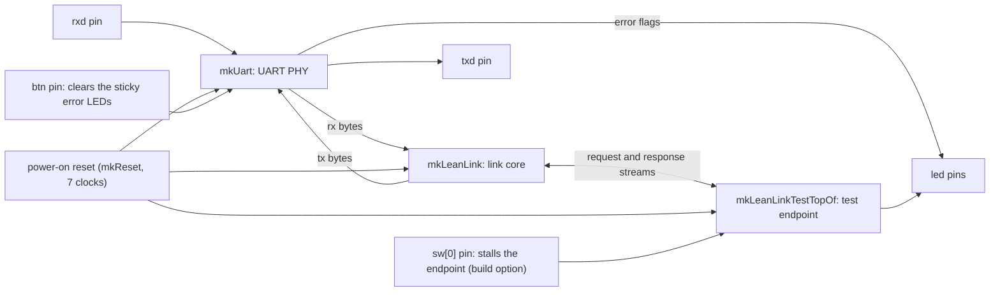
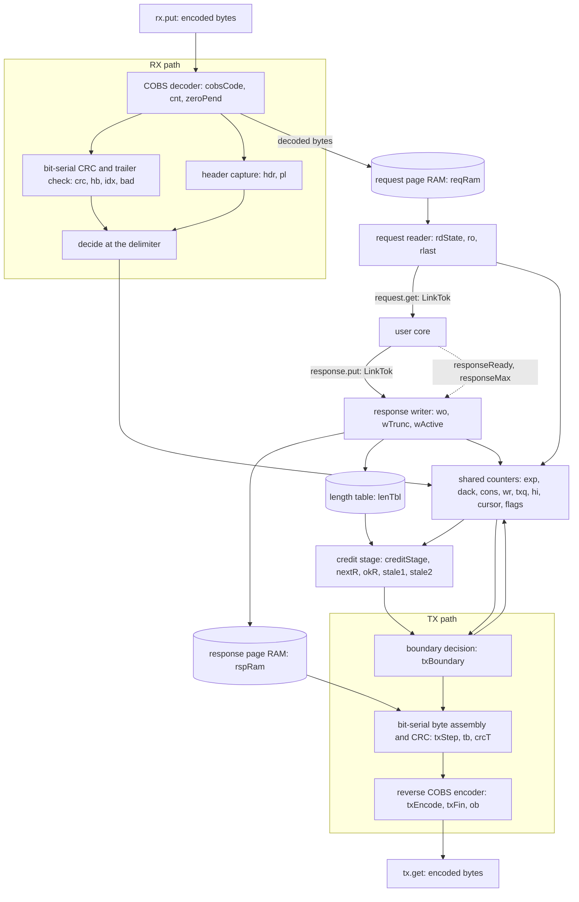

# LeanLink architecture

This document describes the implementation of the LeanLink core in `rtl/LeanLink.bsv`, the test
endpoint and the board top. The wire protocol is in [protocol.md](protocol.md). Signal and
register names are the names in the Bluespec source.

## 1. Overview

The core `mkLeanLink` is a transport core. It has a byte interface to a PHY (a UART), and a
stream interface to a user core (the endpoint). It does the framing, the CRC, the sessions, the
window, the repeat requests (ARQ) and the credit control. It has no FIFO. Its storage is two
page RAMs and a small length table.

The core is parameterized by two numbers:

- `logW`: the window `W = 2^logW` pages per direction (W = 1 to 128).
- `logP`: the page size `P = 2^logP` bytes (P = 16 to 256).

### 1.1 Board top



The synthesizable top is `mkLeanLinkBoard` (`rtl/LeanLinkBoard.bsv`). It has the pin interface
of `mkUartEcho` (a clock, `rxd`, four switches, a button, `txd` and four LEDs). It makes its own
power-on reset. For 7 clocks after configuration it holds the reset and drives `txd` high. The
PHY is the one of `examples/bluespec/uart` (`examples/bluespec/uart/rtl/Uart.bsv`).

The test endpoint `mkLeanLinkTestTopOf` is not idempotent on purpose. It answers each request
with the 32-bit count of requests that it executed before (little-endian), followed by the
request payload. A repeated execution shows up as a skipped count. LEDs: `led[0]` is
`responseReady`, `led[1]` is bit 0 of the count, `led[2]` is a sticky framing, parity or break
error of the PHY, and `led[3]` is a sticky receive overrun of the PHY.

Build options (BSV macros): `LL_LOGW` (default 3) and `LL_LOGP` (default 8) set the link
parameters, `LL_STALL_SW` makes `sw[0]` stall the endpoint, `CLK_HZ` and `BAUD` set the PHY.

### 1.2 Core



The ports of the core are:

| Port | Type | Meaning |
| --- | --- | --- |
| `rx` | `Put#(Bit#(8))` | Encoded bytes from the byte transport. |
| `tx` | `Get#(Bit#(8))` | Encoded bytes to the byte transport. |
| `request` | `Get#(LinkTok)` | Committed requests, whole, in order. |
| `response` | `Put#(LinkTok)` | One response per request, in request order. |
| `responseReady` | `Bool` | True: `response.put` can take a response to its end. |
| `responseMax` | `UInt#(8)` | Payload bytes that a response may have in this session. |

`LinkTok` is a struct with `data` (8 bits), `last` and `empty`.

## 2. Parameters and profiles

| Parameter | Range | Meaning |
| --- | --- | --- |
| `logW` | 0 to 7 | `W = 2^logW`: window, and pages per direction. |
| `logP` | 4 to 8 | `P = 2^logP`: bytes per page. |

Derived values:

- `sb = logW + 1`: the width of the counters `exp`, `dack`, `cons`, `wr`, `txq`, `hi` and `expT`.
  They count modulo 2W. The low `logW` bits are the page number (`pg`).
- `maxLen = min(255, P + 7)`: the largest wire frame length. The largest payload is
  `maxLen - 12`.
- The page address is `{pg, offset}`, with `logW + logP` bits.

The elaboration checks in `mkLeanLink` are:

- `logW > 7` is an error: the sequence fields are one byte (modulo 2W, so 2W is at most 256).
- `logP < 4` is an error: a page needs at least 16 bytes (the header offsets 6 to 11, and the
  payload from offset 12).
- The type provisos also limit `logP` to 8, so that a page offset fits one byte.

The profiles that the project builds and measures are:

| Profile | `logW`, `logP` | W | P | `maxLen` | Largest payload | Page RAM |
| --- | --- | --- | --- | --- | --- | --- |
| W8/P256 (pipelined, board default) | 3, 8 | 8 | 256 | 255 | 243 | 2 x 2048 bytes (block RAM) |
| W1/P64 (minimal) | 0, 6 | 1 | 64 | 71 | 59 | 2 x 64 bytes (LUT RAM) |
| W32/P256 (larger window) | 5, 8 | 32 | 256 | 255 | 243 | 2 x 8192 bytes (block RAM) |

The tops `mkLeanLinkW8P256`, `mkLeanLinkW1P64` and `mkLeanLinkW32P256` in `rtl/LeanLinkTops.bsv`
expose every port of the core, for area measurement. The tops `mkLeanLinkTestW8` and
`mkLeanLinkTestW1` in `rtl/LeanLinkTestTop.bsv` add the test endpoint.

## 3. State

The shared counters and flags have exactly one writer, the rule `updState`. An event that another
block needs (a commit, a clear, a set) goes through a pulse wire to that rule. Every other register
is written by rules and methods whose conditions exclude each other (for example `rdState`,
`txActive`, `obValid`, `tbFull`, `code` and `crcRun`, which have two writers each). A register that
a session reset or another event clears is a `mkRegU` and is cleared inside its writer by
`event || inRst`. `inRst` is the module reset as a value (`isResetAssertedDirect`).

### 3.1 Session and window state

| Register | Width | Writer | Meaning |
| --- | --- | --- | --- |
| `sid` | 32 | `txBoundary` (session reset) | Session ID S of the bound session. |
| `bound` | 1 | `txBoundary` (session reset) | The FPGA has a session. False at reset. |
| `sessGen` | 1 | `txBoundary` (session reset) | Session generation. It toggles at each session reset. |
| `rspLimit` | 8 | `txBoundary` (session reset) | Largest response wire length: `min(pendLimit, maxLen)`. |
| `pendSid` | 32 | `rx.put` (`decide`, valid OPEN) | Session ID of the pending OPEN. |
| `pendLimit` | 8 | `rx.put` (`decide`, valid OPEN) | `rspLimit` of the pending OPEN. |
| `openPending` | 1 | `updState` | An OPEN waits for the session reset. Set by `decide`, cleared by the reset. |
| `owe` | 1 | `updState` | A status frame is owed. Set by `decide` or by the session reset. Cleared at each frame start. |
| `permit` | 1 | `updState` | One status frame may start without credit. Set by RESYNC. Cleared by a status frame or the reset. |
| `rwHost` | 2 | `rx.put` (`decide`) | The REWIND epoch of the last valid host frame. |
| `rwDone` | 2 | `txBoundary` | The epoch that the transmitter has served. |
| `grant` | 16 | `rx.put` (`decide`) | The grant edge. Power-up value `0xFFCC`. |
| `cursor` | 16 | `updState` | Wire bytes started in this session (modulo 2^16). Cleared by the reset. |
| `exp` | sb | `updState` | Next request to accept. Incremented at a commit. |
| `dack` | sb | `updState` | Oldest unacknowledged response (the last valid `ack`). |
| `cons` | sb | `updState` | Requests that the core has read to the last token. Incremented by `request.get` (last token). |
| `wr` | sb | `updState` | Responses that the core has written. Incremented by `response.put` (last token). |
| `txq` | sb | `updState` | The response that the transmitter sends next. Loaded with `dack` after a REWIND or an ACK past it. Incremented at the end of a DATA frame. |
| `hi` | sb | `updState` | The high-water mark: the next new response. Incremented when `txq == hi` at the end of a DATA frame. |
| `tryStatus` | 1 | `updState` | A DATA frame is blocked by credit and a status frame is owed. The next decision prefers the status frame. |

`exp`, `dack`, `cons`, `wr`, `txq`, `hi`, `cursor` and `tryStatus` are cleared by the session
reset and by the module reset. The session reset also sets `owe` (the OPEN reply).

### 3.2 RX registers

| Register | Width | Meaning |
| --- | --- | --- |
| `rxAny` | 1 | Bytes arrived since the last delimiter. |
| `cobsCode`, `cnt`, `zeroPend` | 8, 8, 1 | The COBS code byte of the current block, 1 plus the data bytes received in the block, and "a zero follows this block". |
| `pos` | 8 | Decoded byte index plus 6: the page offset of the next decoded byte. |
| `inHdr`, `inTr`, `tcnt`, `done`, `over` | 1, 1, 2, 1, 1 | The part of the frame (header, trailer), the trailer byte number, "all four trailer bytes seen", "a decoded byte after the trailer". |
| `landOK` | 1 | The frame may write request page `exp mod W` (`(exp - cons) mod 2W < W` at the first byte). |
| `rxGen` | 1 | `sessGen` at the first byte of the frame. |
| `hdr` | 48 | The six header bytes. |
| `pl` | 40 | The last five payload bytes (the OPEN payload). |
| `crc`, `hb`, `idx`, `crcRun`, `trMode`, `tsel`, `bad` | 32, 8, 3, 1, 1, 2, 1 | The bit-serial CRC engine: the CRC register, the byte in work, the bit index, "running", "trailer mode", the trailer byte number, and "a trailer bit did not match". |

### 3.3 Reader, writer and TX registers

| Register | Width | Meaning |
| --- | --- | --- |
| `rdState` | 3 | Request reader state: `RdIdle`, `RdWaitLen`, `RdLen`, `RdWait`, `RdData`, `RdEmpty`. |
| `ro`, `rlast`, `rdStarted` | 8, 8, 1 | The page offset of the reader (11 when idle), the page offset of the last byte of the request (wire length minus 1), "the core took a token of this request". |
| `wo`, `wTrunc`, `wActive` | 8, 1, 1 | The writer offset (12 when idle), the TRUNC flag, "a response is partly written". |
| `txActive`, `txIsData` | 1, 1 | A frame is in progress, and it is a DATA frame. |
| `t`, `vlen`, `phase` | 8, 8, 2 | The page offset of the byte in assembly, the wire length of the frame, and the phase (`THdr`, `TBody`, `TTrl`, `TFin`). |
| `crcT`, `tb`, `tbFull`, `idxT`, `tcntT` | 32, 8, 1, 3, 2 | The TX CRC register, the assembled byte, "the byte is complete", the bit index, the trailer byte number. |
| `expT` | sb | `exp` as sampled at the first bit of a header byte. |
| `code`, `finCode` | 8, 1 | The rCOBS run length plus one, and "the final code went out". |
| `ob`, `obValid` | 8, 1 | The output byte, and "it waits for the PHY". `ob` is `0x00` and valid after reset. |
| `lenTbl` | W x 9 | The response length table: `{TRUNC, wire length}` per page. A `RegFile`. |
| `nextR` | 16 | `creditStage`. `cursor + vC`, registered: the cursor value after the frame that the decision would start. |
| `okR` | 1 | `creditStage`. The credit verdict for the selected frame kind, from `grant - nextR`. |
| `stale1`, `stale2` | 1, 1 | `creditStage`. The freshness guard (Section 6.5). True after reset. |

### 3.4 Counter invariants

Differences are modulo 2W (`sb` bits). While no OPEN is pending:

- `cons <= exp` and `exp - cons <= W`. A frame commits only when `exp - cons < W` at its first
  byte, so the pages from `cons` to `exp` never exceed W.
- `dack <= txq <= hi <= wr`. TX starts a DATA frame only when `txq != wr`. `hi` moves only when
  a frame ends with `txq == hi`. An `ack` is valid only inside `[dack, hi]`. After a REWIND,
  `txq` goes back to `dack`.
- `wr - dack <= W`. `responseReady` is true only if `wr - dack < W` (and the page that TX reads is
  not the page of `wr`).
- `cursor` grows by the wire length of each started frame. After the session reset it is 0.

While an OPEN is pending, the response writer accepts and drops tokens. It still increments `wr`
at the last token, so that the core can reach quiescence (`cons == wr`). The bound above does not
hold then. The session reset sets all of these counters to 0.

The reader is idle (`rdState == RdIdle`) and the writer is idle (`!wActive`) at quiescence, in
addition to `cons == wr`.

## 4. RX path

### 4.1 Per-byte processing

`rx.put` accepts a byte only when `crcRun` is false. For each byte:

- A zero byte is the delimiter. If `rxAny` is set, the rule `decide` runs, in the same clock. A
  delimiter with no bytes before it does nothing.
- The first byte after a delimiter is a code byte. It starts a frame: `cobsCode := b`,
  `cnt := 1`, `pos := 6`, the flags are cleared, the CRC register is set to all ones, `landOK` and
  `rxGen` are latched.
- A byte that arrives with `cnt == cobsCode` is the next code byte (`blockEnd`). If `zeroPend`
  is set, the implied zero byte is decoded first. The new code is stored.
- Any other byte is a data byte. It is decoded, and `cnt` is incremented.

The decoder has one counter and one 8-bit equality compare (`cnt == cobsCode`). It has no
subtractor and no load multiplexer.

### 4.2 Decoded bytes

For each decoded byte `d` (`decoded(d)`):

1. If `landOK`, the byte goes to the request page RAM at `{pg(exp), pos}`. The write happens
   before the frame is checked. The page content is used only if the frame commits.
2. `pos` is incremented.
3. The byte goes to one of three places: the header register `hdr` (the first six bytes), the
   trailer check (the byte at offset `hLen`, then the next three), or the payload shift register
   `pl` (the last five payload bytes).
4. The byte starts a bit-serial step (`crcLoad`): `hb := d`, `crcRun := True`. For eight clocks
   the rule `rxCrcStep` shifts one bit (least significant bit first) through the CRC register. In
   the trailer the register shifts without feedback. Each trailer bit is compared with
   `~crc[0] XOR S[bit]`. A mismatch sets `bad`. S is `sid`, or 0 when the frame is an OPEN frame
   or the FPGA is unbound.

### 4.3 The decision at the delimiter

At the delimiter `decide` evaluates `fmtOk`: the block ended at the delimiter (`blockEnd`), all
four trailer bytes arrived and no byte followed (`done`, `!over`), the trailer matched (`!bad`),
the generation did not change (`rxGen == sessGen`), the version is `10`, `seq` and `ack` are
below 2W, `hLen` is in 12 to `maxLen`, and the frame kind rule holds (OPEN: `len = 17`, no DATA,
`rspLimit >= 12`; other: DATA, or `len = 12`).

Then the rules of protocol.md Section 5 apply:

```
if !fmtOk:           if !bound: owe := 1
elif OPEN:           pendSid, pendLimit := payload; grant := hdr.grant; openPending := 1
elif !bound:         owe := 1
elif !openPending and ackOk:
    dack := ack; grant := hdr.grant; rwHost := hdr.rewind
    if DATA and seq == exp and landOK:  exp := exp + 1          (commit)
    if (DATA and not commit) or POLL or RESYNC:  owe := 1
    if RESYNC:  permit := 1
```

`ackOk` is `(ack - dack) <= (hi - dack)`. The length of a committed request is the byte at page
offset 11. The reader uses it.

### 4.4 RX timing

- One decoded byte occupies the CRC engine for 8 clocks. `rx.put` is not ready during these
  clocks, so it is ready again 9 clocks after the byte. A code byte that implies a zero byte also
  decodes one byte, so every wire byte costs at most 9 clocks. A zero byte (the delimiter)
  costs one clock: `decide` is combinational.
- The PHY delivers one byte per 83 clocks at 12 Mbaud and 100 MHz (10 bits at 8.33 clocks each).
  The RX needs 9 clocks per byte. The margin is a factor of 9. So `rx.put` is ready every time a
  byte arrives, and the UART never needs to stall or to buffer more than the byte in its shift
  register. The decision does not wait for the TX, the core or the credit.
- Measured: in a test with a 255-byte response in flight and frames arriving at the full rate,
  no byte waited at the end of a clock (the byte that arrives in the clock counts as 1). A sweep
  of the byte gap shows no backlog down to a gap of 9 clocks per byte. At 8 clocks the backlog
  grows.

## 5. Request reader and response writer

### 5.1 Request reader

The reader reads page `cons` of the request RAM. The RAM has one clock of read latency.

```
RdIdle:    if cons != exp and !openPending: RdWaitLen            (ro is 11)
RdWaitLen: RdLen
RdLen:     l := RAM byte (offset 11, the wire length); rlast := l - 1; ro := 12
           RdEmpty if l == 12, else RdWait
RdWait:    RdData
RdData:    request.get returns RAM byte; last if ro == rlast
           last: cons := cons + 1; RdIdle; ro := 11.  Not last: ro := ro + 1; RdWait
RdEmpty:   request.get returns {empty, last}; cons := cons + 1; RdIdle
```

The reader delivers one token every two clocks. While an OPEN is pending and the core has not
taken a first token (`rdStarted` is false), the reader abandons the request and returns to
`RdIdle`. A request that the core has started is read to its end.

### 5.2 Response writer

`response.put` is ready when `rspReady = openPending || (wr - dack < W && !pageBusy)`. Here
`pageBusy` means that TX sends a DATA frame from page `wr mod W`.

For each token with a byte: if `wo != rspLimit`, the byte goes to the response RAM at
`{pg(wr), wo}` and `wo` is incremented. Otherwise the byte is dropped and TRUNC is set. At the
last token, `lenTbl` gets `{TRUNC, wo}` for page `pg(wr)`, `wr` is incremented, and `wo` returns
to 12. A token with `empty` and without `last` changes nothing. A token with `empty` and `last`
ends a zero-length response (wire length 12).

During an OPEN (`openPending`), `put` writes nothing to the RAM or the length table. The tokens
are dropped. At W = 1 the page of `wr` can be the page that TX sends, so a write could change a
frame that is on the wire.

`responseMax` is `rspLimit - 12`.

## 6. TX path

### 6.1 Boundary decision

When TX is idle (`!txActive`), the rule `txBoundary` takes one decision per clock:

```
if openPending:
    if quiescent: session reset
elif rwHost != rwDone or behind:      txq := dack; rwDone := rwHost
elif not stale:                       (Section 6.5)
    if txq != wr and not tryStatus:
        if okR:                       start DATA frame
        elif owe:                     tryStatus := 1
    else:
        tryStatus := 0
        if owe and (okR or permit):   start status frame; permit := 0
```

`behind` means `txq` is below `dack`. `quiescent` is `rdState == RdIdle && !wActive && cons == wr`.

Credit: `V` (named `vC` in the source) is `lenTbl[txq]` (the wire length) for a DATA frame and 12
for a status frame. `next = cursor + V`, and `d = grant - next` as a signed 16-bit number. Data
needs `d >= 0`. A status frame needs `d >= -64` (`d[15:6]` all ones, or `d[15] == 0`). The
registers `nextR` and `okR` hold `next` and the verdict (Section 6.5). `okR` is the verdict for
the kind of frame that the decision selects (`useData`).

A start sets `txActive`, `txIsData`, `vlen := V`, `t := 6`, `phase := THdr`, `crcT := all ones`,
`code := 1`, clears `owe`, and sets `cursor := nextR`.

The session reset (`txBoundary`) sets `sid`, `rspLimit`, `bound`, flips `sessGen`, copies
`rwHost` to `rwDone`, and pulses `resetW` and `txSetOweW`. `updState` clears the counters.

`tryStatus` keeps a blocked DATA frame from starving the status frames. When a DATA frame lacks
credit and a status frame is owed, the next decision takes the status branch once. If a RESYNC
grant arrives while this happens, either the DATA frame or the permitted status frame can go
first. Both orders are valid: the permit stays set until a status frame uses it.

### 6.2 Byte assembly

TX builds each byte one bit per clock (rule `txStep`), least significant bit first. The same bit
goes into the byte register `tb` and into the bit-serial CRC `crcT`.

- Header bytes (offsets 6 to 11) come from one-bit selections: `ctl` is
  `{2'b10, 0, txIsData, txIsData & TRUNC, logW}`, `seq` is `txq`, `exp` is the sampled value, the
  cursor bytes are selected by `cursor[{t[1], idxT}]`, and `len` is `vlen` for a DATA frame or
  `maxLen` for a status frame.
- Body bytes (payload) come from `rspRam.b.read[idxT]`. The address `{pg(txq), t}` stays constant
  for the 8 bits of a byte and `t` advances at bit 7.
- Trailer bytes come from `~crcT[0] XOR S[bit]`, with S from `sid[{tcntT, idxT}]`, or 0 when
  the FPGA is unbound. In the trailer the CRC register shifts without feedback.
- `exp` is the one field that RX can change during a frame (a commit). It is sampled into `expT`
  at the first bit of the byte, so each byte is a snapshot of `exp`. The value can be newer than
  the value at the frame start, and it is always a valid `exp`.

### 6.3 Reverse COBS encoder

When `tbFull` is set and the output byte register `ob` is free, `txEncode` moves the byte on:
if `tb` is zero, `ob := code` and `code := 1`; else `ob := tb` and `code := code + 1`. After the
last trailer byte, `txFin` sends the final code, then the delimiter, and clears `txActive`. At the
end of a DATA frame `txq` advances (and `hi`, if `txq == hi`). The PHY takes `ob` through
`tx.get`. After a reset `ob` holds a delimiter (`0x00`) and it is valid, so the first byte out is
a delimiter.

### 6.4 TX timing

- A byte takes 8 clocks to assemble and one clock to encode, about 10 clocks in all. The PHY slot
  is 83 clocks at 12 Mbaud and 100 MHz. The assembly runs while the PHY sends the previous byte.
- When a frame ends, `txBoundary` takes the next decision as soon as the guard of Section 6.5
  allows. The first byte of the next frame is ready about 10 clocks after the start, far inside
  the PHY slot. The test suite measures 0 idle PHY slots between back-to-back frames, for 7 ready
  responses, in W8 and W1.
- Writing a 200-byte response while TX sends another frame takes 399 clocks (the test endpoint
  moves one token per two clocks, so this is the reader and writer pace, not the RAM).

### 6.5 Timing of the start decision

The credit check has two registered stages. They are written every clock by the rule
`creditStage`:

1. `nextR <= cursor + vC`, where `vC` is the wire length from `lenTbl[txq]` if `useData`
   (`txq != wr` and not `tryStatus`), else 12.
2. `okR <= d[15] == 0 || (!useData && d[15:6] == all ones)`, with `d = grant - nextR`. This is
   the verdict for the selected frame kind: data needs `d >= 0`, and a status frame needs
   `d >= -64`.

`txBoundary` reads only `okR`. A start reuses `nextR` as the new `cursor`, so the length table
read, the two carry chains and the start enables are in different clocks.

**Freshness guard.** The registered values equal the direct test only if no input changed in the
last two clocks. The two bits `stale1` and `stale2` record this:

- `stale1` is set when, in this clock, the core writes `grant` (both sites in `decide`), `cursor`
  (a start), `txq` (`txLoadW`, `txEndW`) or `wr` (`wrIncW`), writes `lenTbl`, performs a session
  reset, or changes `tryStatus` (`modeChange`: an actual change, not a write of the same value).
- `stale2` is `stale1` one clock later. Both bits are True after the module reset.
- `stale` is `stale1 || stale2`. While `stale` is true, the start branches of `txBoundary` do
  nothing. The session reset, the REWIND load of `txq` and the OPEN branch do not wait for it.

The argument: suppose that the decision runs at clock T with `stale` false. No input was written
at T-1 or T-2. The value of `nextR` at T comes from the inputs at T-1. The value of `okR` at T
comes from `nextR` at T-1 (inputs at T-2) and `grant` at T-1. All these inputs equal their
values at T. So `nextR` and `okR` equal the direct test on the live values. The decision still
reads `txq != wr`, `tryStatus`, `owe`, `permit`, `behind`, `rwHost` and `openPending` live, and
they need no guard. Every write site of `grant`, `cursor`, `txq`, `wr`, `tryStatus` and
`lenTbl` is in the guard.

**Delay.** A start waits for two clocks with no such write. Normally this is a few clocks. While
responses complete back to back, each `wr` increment arms the guard again, so the wait is at most
about 2W clocks (16 clocks for W = 8). A switch to a status frame after a DATA attempt that lacked
credit adds about 3 clocks. The byte time is 83 clocks at 12 Mbaud and 100 MHz, so for W = 8 the
guard never delays a frame by a byte time. The guard changes no frame: it only moves a start by
a few clocks. The shipped tests cover the guard through the behavior of the link (the frames, the
credit and RESYNC cases and the stress test), and this document claims no more.

**Reader end test.** The request reader tests `ro == rlast`, where `rlast` is the length byte
minus 1, set at `RdLen`. The test is one equality with no carry chain in the path from `ro` to
the last token.

On the STLV7325 build at 200 MHz, the critical path is `ro`, `ro == rlast`, `last`, and the
count enable of the test endpoint (4.67 ns). The build meets timing (Section 8.2).

## 7. Storage

| Memory | Size | Ports | Implementation |
| --- | --- | --- | --- |
| `reqRam` | W x P bytes | Port a: RX write. Port b: reader read. | `mkBRAMCore2` |
| `rspRam` | W x P bytes | Port a: writer write. Port b: TX read. | `mkBRAMCore2` |
| `lenTbl` | W x 9 bits | One write (`put`), one read (`txBoundary`). | `RegFile` (`mkRegFileWCF`) |

Each page RAM has one writer and one reader. The address is `{pg, offset}`, `logW + logP` bits.
Request page `s mod W` holds request `s`. Response page `s mod W` holds response `s`.

A page is a ring of P bytes. A request frame writes its decoded byte `k` at offset `k + 6`: the
header at 6 to 11 (the `len` byte at offset 11), the payload from 12, and the trailer after it.
Response payload byte `j` is at offset `12 + j`. The offset wraps modulo P. The longest payload
(`P - 5` bytes for P below 256) wraps over header bytes that nobody reads back, and the `len`
byte at offset 11 is not overwritten. For P = 256, the largest payload is 243 bytes by the
253-byte frame limit.

How the tools map the memories (BSC 2026.07.1, Yosys 0.70 `synth_xilinx`, 7-series):

- W8/P256: each page RAM is 2048 x 8 bits, one RAMB18E1. The two RAMB18 are the only block RAM.
  `lenTbl` (8 x 9 bits) is two RAM32M, 8 LUT RAM.
- W1/P64: each page RAM is 64 x 8 bits. Both are LUT RAM: six RAM64M, 24 LUT RAM in all.
- W32/P256: each page RAM is 8192 x 8 bits, two RAMB36E1 per RAM, so four in all. `lenTbl` is two
  RAM32M.

## 8. Area techniques

The core is small because of these techniques.

| Technique | What it does | Measured |
| --- | --- | --- |
| Clears through the FF reset pin | The registers of the session reset are `mkRegU`. Their single writer `updState` writes `clr ? init : (event ? next : hold)` with `clr = resetW \|\| inRst`. Yosys uses `clr` as the synchronous reset of the FF and `event` as the clock enable. The same pattern re-initializes `wo`, `wTrunc`, `wActive` (rule `wUpd`) and `ro` (rule `roUpd`). | The clear costs no LUT. |
| COBS up counter | The decoder stores the code byte and counts up (`cnt == cobsCode`). A down counter would need a load subtractor and a load multiplexer. | Costs 8 FF. |
| Bit-serial TX assembly | One bit per clock into `tb` and into the bit-serial CRC. This removes the 8-bit three-way byte multiplexer. | The assembly needs no byte multiplexer. |
| Bit-serial CRC and trailer check | RX and TX shift one bit per clock through the 32-bit CRC register. There is no byte-wide XOR network and no 32-bit comparator. The RX compares each trailer bit with `~crc[0] XOR S[bit]`. | The bit-serial CRC engine is 29 logic LUT as `mkRegU`, and 36 with a reset register |
| Pipelined credit check (timing, not area) | Two registered stages and a two-bit guard (Section 6.5), and the reader end test `ro == rlast`. | Costs LUT and FF. The STLV7325 build meets 200 MHz. |
| `mkRegU` for per-frame registers | A register that every frame initializes has no reset logic. | Not measured alone |
| One writer for the shared counters | Cross-block requests are pulse wires and flag pairs. No arbitration logic. | Not measured alone |
| No FIFO in the core | Block RAM or LUT RAM pages, and a `RegFile` for the length table. | Not measured alone |
| Counters of `log2(2W)` bits | The wire byte is the counter, zero-extended. | Not measured alone |

`ConfigReg` (a register whose read and write do not order the rules) is used for `sid`, `bound`,
`sessGen`, `rspLimit`, `txActive` and `txIsData`, so that the rules that read and write them stay
conflict-free.

### 8.1 Measured area

The numbers come from the xeda `yosys_fpga` flow on the targets `core_w8` and `core_w1` of
`uart_link.yaml` (Artix-7 `xc7a100tcsg324-1`, 10 ns), with BSC 2026.07.1 and Yosys 0.70:
`xeda run yosys_fpga examples/bluespec/uart_link/uart_link.yaml --target core_w8`. These targets
map the core alone (`rtl/LeanLinkTops.bsv`) with every port observable; the PHY and the endpoint
are not included. LUT RAM is the RAM32M and RAM64M cells at four LUTs each.

| Profile | Logic LUT | LUT RAM | FF | CARRY4 | Block RAM |
| --- | --- | --- | --- | --- | --- |
| W8/P256 (`core_w8`) | 370 | 8 | 461 | 36 | 2 RAMB18 |
| W1/P64 (`core_w1`) | 332 | 24 | 462 | 26 | 0 |

Both profiles need fewer than 500 logic LUTs.

### 8.2 Boards: area and timing of the board top

The board top `mkLeanLinkBoard` (link, UART PHY and test endpoint, W8/P256) was built with the
xeda flows and run on the boards.

| Board | Clock | Flow and tool | Area | Timing |
| --- | --- | --- | --- | --- |
| Arty A7-100T | 100 MHz, 12 Mbaud | `vivado_synth`, Vivado 2025.2 | 454 LUT (434 logic), 560 FF, 2 RAMB18 | WNS +2.917 ns (setup) |
| Basys-3 | 100 MHz, 12 Mbaud | `vivado_synth`, Vivado 2025.2 | 453 LUT (433 logic), 560 FF, 2 RAMB18 | WNS +2.788 ns (setup) |
| ULX3S 85F (ECP5) | 25 MHz, 3 Mbaud | yosys + nextpnr-ecp5 0.11.1 | 846 TRELLIS_COMB, 635 FF, 2 DP16KD | Fmax 79.0 MHz, met |
| STLV7325 (Kintex-7) | 200 MHz, 3 Mbaud | yosys + nextpnr-himbaechel 1.0.0 (openXC7) | 560 LUT, 586 FF, 2 RAMB18 | Fmax 214.0 MHz, met (WNS +0.328 ns) |

The UART PHY and the test endpoint are part of these numbers (about 150 LUT of the Arty design are
in the PHY). The STLV7325 build ran with the default nextpnr settings. The critical path is
described in Section 6.5.

## 9. Connect your own endpoint

An endpoint talks to the core through the stream ports. It must follow the core contract of
protocol.md Section 7.2:

- Read every request up to its last token.
- Write exactly one response per request, in request order.
- Before a side effect, check `responseReady`. Check that the result fits `responseMax`.

A minimal endpoint that echoes each request:

```bsv
import GetPut :: *;
import LeanLink :: *;

module mkEchoEndpoint#(LeanLink#(logW, logP) link)(Empty);
   // Both methods have implicit conditions: a request token is available, and the response
   // writer can take it. Once a response has started, the writer stays ready until its last token.
   rule echo;
      LinkTok t <- link.request.get;
      link.response.put(t);
   endrule
endmodule
```

The board top connects the core to a UART and to an endpoint like this:

```bsv
LeanLink#(3, 8) link <- mkLeanLink;           // W = 8, P = 256
Uart#(8) uart <- mkUart;
mkConnection(uart.rx, link.rx);               // PHY bytes into the core
mkConnection(link.tx, uart.tx);               // core bytes to the PHY
mkEchoEndpoint(link);
```

An endpoint with a side effect (for example, a counter that must not run twice) reads the
request, then checks `responseReady`, and writes the response in order. `mkLeanLinkTestTopOf` in
`rtl/LeanLinkTestTop.bsv` is a reference: it takes the first token, writes four count bytes, then
the held token, then the rest of the request, and it increments its count at the last token. A
core that cannot answer a request within the response limit uses `responseMax` to cut the
response itself. If it does not, the writer drops the excess and sets TRUNC.

A request that the core has not started is abandoned when an OPEN arrives. A request that the
core has started must be served to its end. The core does not need to know about sessions.

## 10. Verification

The example ships these checks. Each one can be rerun. The commands are in the README of the
example.

- **Bluespec bench** (`tb/TbLeanLink.bsv`, frames in `tb/LeanLinkFrames.bsv`). A behavioral host at
  the byte interface plays the frames that `tb/gen_frames.py` writes with the Python codec, and
  compares every byte that the link sends: the delimiter after reset, the UNBOUND status frame, the
  OPEN reply, a request and its response, a frame with a wrong CRC and one with a wrong COBS
  structure (neither runs), a duplicate request, an empty request and the largest request (TRUNC).
  It runs with `xeda run bsc_sim` in Bluesim, Icarus Verilog and Verilator. With the macro
  `XEDA_INJECT_BUG` the test endpoint counts each request twice, and the bench must fail.
- **cocotb tests** (`tb/lean_*.py`, `tb/cosim.yaml`). They run on the Verilog that `bsc` makes
  from the core, with Verilator, and use the Python codec for every frame. They cover:
  rejection of damaged frames (a flipped bit at every byte position, inserted and deleted bytes,
  truncation, merged frames, wrong version, wrong length, wrong session); sessions (OPEN, UNBOUND,
  quiescence, the generation bit); duplicates, gaps, REWIND and ACK; credit (the status
  reserve, RESYNC, the power-up grant, the wrap of the 16-bit counters); windows and the wrap of
  the sequence numbers; every request size; the core port on the bare core (token flags, TRUNC,
  the response limit); and performance at 12 Mbaud and 100 MHz (RX backlog, response write time,
  TX idle). The leading delimiter after reset is covered here. The Xeda test suite runs a subset
  of these tests. `tb/run_cosim.py` runs the full suite on four targets (W8, W1 and the two bare
  cores) with a number of random seeds of your choice.
- **Stress test** (`tb/lean_stress.py`, part of the full suite). A random host (OPEN with
  retries, window, go-back-N, REWIND, POLL, RESYNC) runs against random faults in both
  directions: lost, inserted and changed bytes, truncated, dropped and duplicated frames, lost
  delimiters, and blackouts. It checks the exact response of every request and that the executed
  count has no gap and no repeat. A failing seed is the reproduction.
- **Host library tests** (`tests/test_uartlink_host.py` in the Xeda tests). They cover the codec,
  the host state machine, the device and its backends (with fakes for `pyserial` and `pyftdi`),
  the frame-level FPGA model and the protocol simulation with fault injection.
- **Protocol simulation** (`python3 -m leanlink.sim campaign`). It runs the host library against
  the Python FPGA model, which is an independent reading of the specification. It injects lost,
  inserted and changed bytes, truncation, lost delimiters, FPGA reboots, bridge overflow, host
  pauses, blackouts and stale senders, and checks that no request runs twice, that every result is
  exact or a terminal unknown outcome, and that the bridge never holds more than B bytes.
- **Hardware** (`host/hw_suite.py`, with the board top). The script uses the host library only. It
  checks every echo byte and every execution count, and it flags a count jump that is larger than
  the number of requests with an unknown outcome. Results of the current core, by board:

| Board | Soak of 100,000 requests (random sizes from 0 to the maximum) | Fault injection (1e-3 per byte, both directions, 60,000 requests) | Reconfiguration with a full window: UNBOUND seen |
| --- | --- | --- | --- |
| Arty A7-100T | exact, no violation | exact, no unknown outcome | 10 of 10 |
| Basys-3 | exact, no violation | exact, no unknown outcome | 5 of 5 |
| ULX3S | exact, no violation | exact, no unknown outcome | 10 of 10 |
| STLV7325 | exact, no violation | exact, no unknown outcome | 15 of 15 |

  Blackouts of 200 ms (4000 requests per run, three blackouts) ended with every response exact and
  the session kept, on every board. After a reconfiguration, the host saw UNBOUND, the requests
  without a response became unknown outcomes (none ran twice), and the new session started at
  count 0. The first byte on the line after configuration is the delimiter `0x00`. It was
  captured on the Arty, the Basys-3 and the STLV7325. The ULX3S programmer owns the serial port
  during programming, so the byte cannot be captured there, but the host saw UNBOUND in every
  reconfiguration run. On the Arty with `pyftdi` (1 ms latency timer and event character `0x00`),
  the goodput with the largest payload is 1113 kB/s (93% of the 12 Mbaud line rate) and the
  median round trip of a 16-byte request is 0.26 ms. The README has the goodput of the other
  boards. All of these numbers come from a host machine under heavy load, so they are lower
  bounds.
