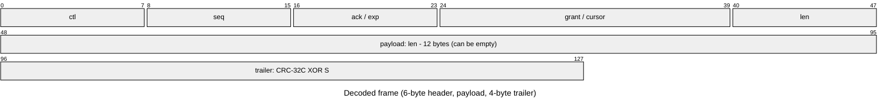
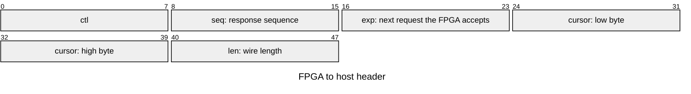
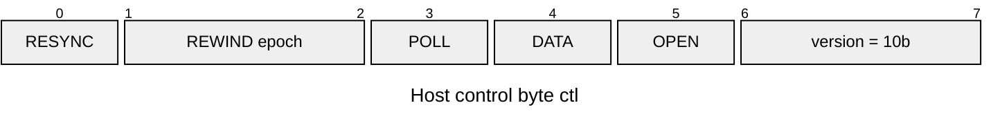
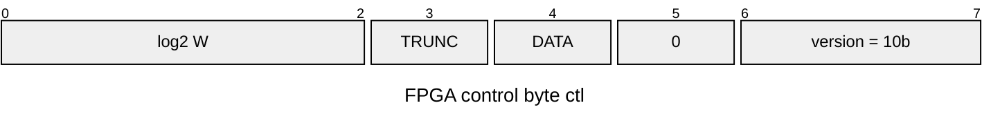
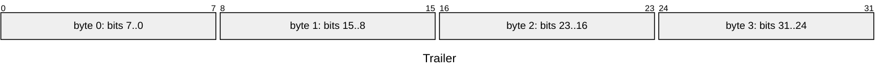
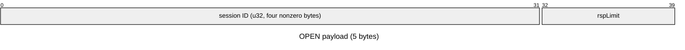
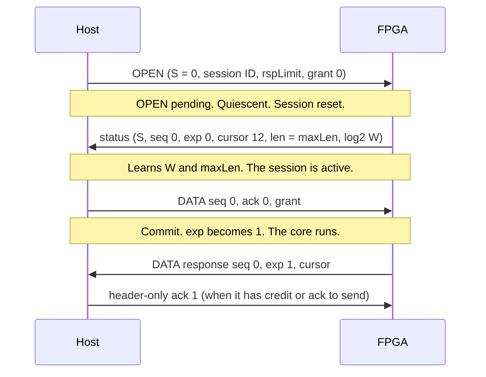
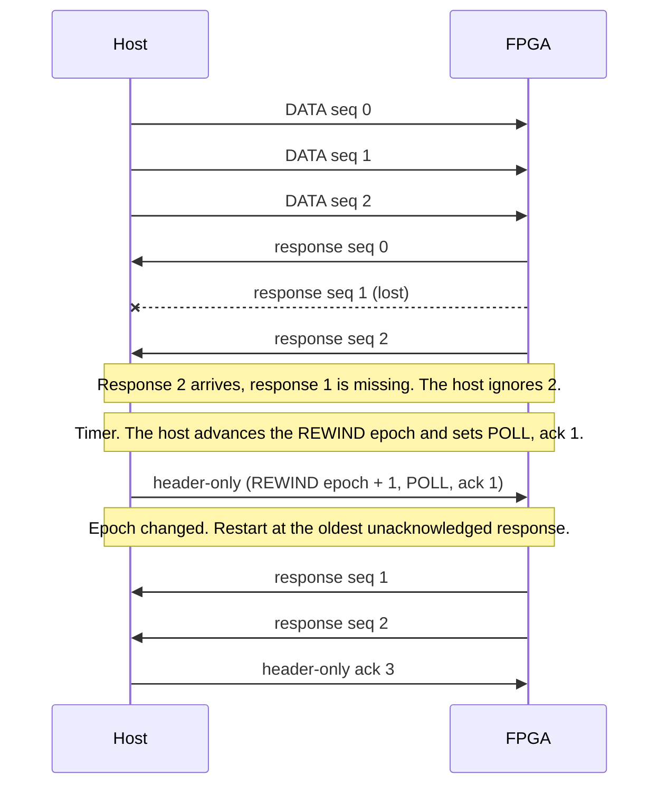
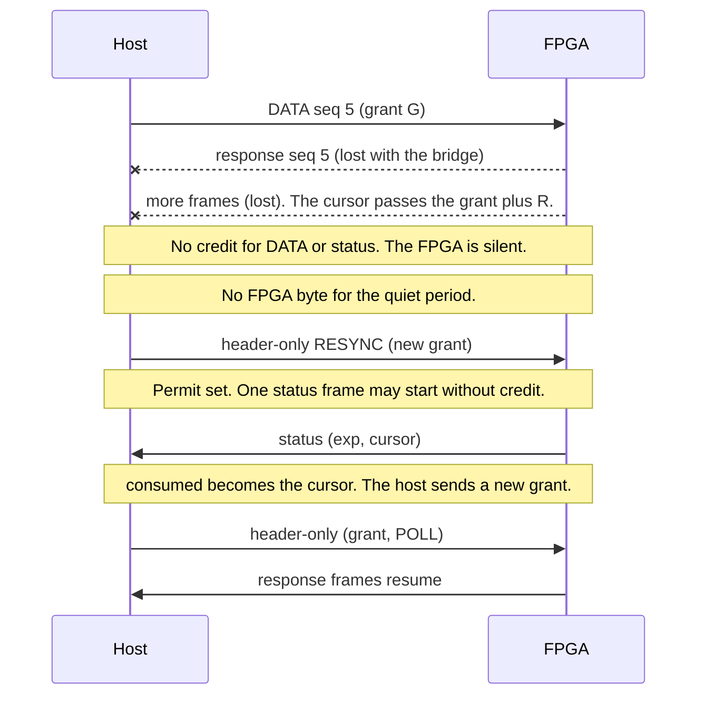
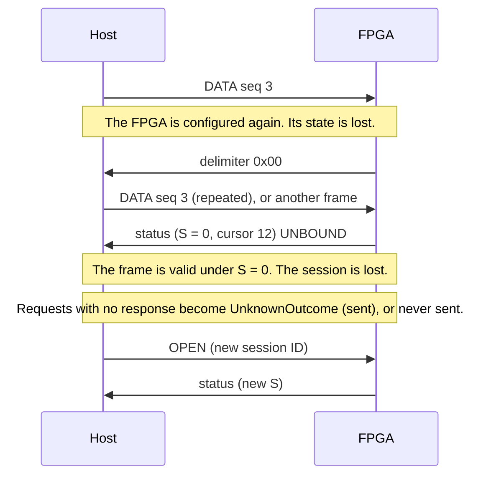

# LeanLink protocol

LeanLink is a small reliable packet transport over a byte stream, for example a UART behind a
USB bridge. It carries requests from a host to an FPGA core and responses back. This document
is for people who write a host, or another FPGA side, that talks this protocol. It is the
specification of the wire format and of the behavior of both ends. The implementation is in
[architecture.md](architecture.md). The host library is in [host.md](host.md).

All numbers in this document are decimal unless they have a `0x` prefix or an `h` suffix. All
multi-byte fields are little-endian.

## 1. Goals and assumptions

### 1.1 What the protocol gives

- **No silent re-execution.** The FPGA commits each request at most once per session. The host
  never sends a request again in a new session.
- **Terminal unknown outcomes.** If the session is lost, every request without a response is
  reported as an unknown outcome. The host does not retry such a request by itself. Only the
  user can decide to send it again.
- **In-order responses.** The core answers requests in the order in which they arrive. The
  responses reach the host in the same order, each one exactly once.
- **Detection of damage.** Every frame has a CRC-32C. A frame with a lost, changed, inserted or
  truncated byte is dropped. The ARQ (automatic repeat request) of Section 5 recovers it.
- **Bounded buffering in the bridge.** The FPGA sends only the bytes that the host has granted
  (Section 6). A bridge that holds the number of bytes that the host chose never overflows.
- **A pipeline.** The host may keep W requests in flight. W is a build parameter of the FPGA
  from 1 to 128, a power of two.

### 1.2 Channel model

- The channel is an in-order byte stream in each direction. It may lose, corrupt or insert
  bytes. It never reorders bytes, and it never delivers an old byte again later (no replay).
- The bridge between the two ends buffers a known number of bytes. The host knows this number.
- The decoder of each side is reset by a delimiter byte (`0x00`), so a damaged frame never
  affects a later frame.

### 1.3 What the protocol does not do

- **No forward error correction.** A damaged frame is dropped and sent again.
- **No protection against replay.** An old OPEN frame that the channel delivers again binds the
  old session again. Old request frames that follow it could then run again. A UART or a USB
  serial bridge cannot replay frames, so the protocol does not defend against it.
- **No authentication.** The session ID is not a secret. It separates the frames of one session
  from the frames of another by the CRC.
- **No back pressure from the core to the host.** A slow core fills the window. Then the host
  waits (Section 5.2). The core signal `responseReady` only holds back the core itself.

Residual risk: a damaged frame passes if the damage keeps the CRC-32C valid. For a random damage
the chance is about 2^-32 per frame that reaches the CRC check.

## 2. Framing

Each frame is one packet. A zero byte (`0x00`, the delimiter) ends every frame. No zero byte
appears inside a frame on the wire. Two different codings remove the zero bytes.

| Direction | Coding | Why |
| --- | --- | --- |
| Host to FPGA | COBS (consistent overhead byte stuffing) | The FPGA decodes it with one 8-bit counter. |
| FPGA to host | Reverse COBS (here: rCOBS), a streaming code | The FPGA encodes it byte by byte, with no buffer. |

### 2.1 COBS (host to FPGA)

COBS puts a code byte `c` in front of each block. The block is `c - 1` nonzero data bytes. A
code `c` other than `0xFF` means that a zero byte follows the block, unless the frame ends. The
decoder needs only a counter. A frame starts with a code byte.

### 2.2 rCOBS (FPGA to host)

rCOBS puts the code byte after the block. It replaces the zero byte that ended the block:

- A nonzero byte goes out unchanged. The encoder counts the nonzero bytes of the current run.
- A zero byte goes out as the code `run + 1`. The run count restarts.
- At the end of the frame the encoder sends one more code, for the last run. The code is 1 if
  the last run is empty.

The host decodes a wire frame from its last byte backward. The last byte `c` is the code of the
last run. The `c - 1` bytes before it are the run. The byte before the run is the code of the
previous run, and it stands for one zero byte between the two runs. The first run must start
exactly at the first byte of the wire frame. Anything else is a structure error.

### 2.3 Sizes

- A decoded frame has at most 253 bytes.
- The wire length of a frame is its decoded length plus 2: one code byte, and the delimiter.
  The largest wire frame has 255 bytes.
- Because a decoded frame has at most 253 bytes, the code `0xFF` (254 data bytes in a block or
  run) never appears in a valid frame. The FPGA never sends it. The FPGA treats a wire frame that
  contains it as invalid.
- The smallest frame has 10 decoded bytes (header and trailer) and 12 wire bytes.
- The largest payload is 243 bytes. A build may allow less (Section 3.2).

### 2.4 Delimiters

- A delimiter that arrives when no byte came since the last delimiter is not a frame. Both
  ends ignore it.
- After an FPGA reset, the first byte that the FPGA sends is a delimiter. It ends any partial
  frame that the host still holds from before the reset, so the next frame does not join it. This
  delimiter is not counted in the cursor (Section 6).
- If a delimiter is lost, two frames join into one. Its decoded length does not match its `len`
  field, so the receiver drops both (Section 8).

## 3. Frame layout

All frames have the same layout.



The order of bytes on the wire is `ctl`, `seq`, `ack` or `exp`, the two bytes of `grant` or
`cursor`, `len`, the payload, then the four bytes of the trailer. In the diagrams of this
document, the number above a box is a bit position. Bit 0 is the least significant bit, and the
leftmost box of a row has the lowest bit number. The diagram of the whole frame shows the
payload and the trailer as rows of 48 bits only to fit the picture.

### 3.1 Header

The header has six bytes. The meaning of the third and fourth fields depends on the direction.




| Offset | Host to FPGA | FPGA to host |
| --- | --- | --- |
| 0 | `ctl` | `ctl` |
| 1 | `seq`: sequence number of this request | `seq`: sequence number of this response. In a status frame: the next response to send. |
| 2 | `ack`: the next response that the host needs | `exp`: the next request that the FPGA accepts |
| 3-4 | `grant`: the data grant edge (u16) | `cursor`: the transmit cursor after this frame (u16) |
| 5 | `len`: the wire length of this frame | `len`: the wire length of this frame. In a status frame: `maxLen`. |

- `len` is the wire length: the payload length plus 12 (6 header bytes, 4 trailer bytes, the
  COBS code byte and the delimiter). The valid range is 12 to `maxLen`.
- A frame is invalid if its decoded length is not `len - 2`.
- `seq`, `ack` and `exp` are counters modulo 2W. The bits above log2(2W) must be 0. With
  W = 1 these fields are 0 or 1. With W = 128 they are 0 to 255.
- `maxLen` is the largest wire length that a build accepts and produces. It is
  `min(255, P + 7)`, where P is the page size in bytes (Section 3.2 and `architecture.md`).
- `grant` and `cursor` are explained in Section 6.

### 3.2 Control byte

Host to FPGA:



FPGA to host:



| Bits | Host to FPGA | FPGA to host |
| --- | --- | --- |
| 7:6 | version, `10` | version, `10` |
| 5 | OPEN | reserved, 0 |
| 4 | DATA: the frame carries a request | DATA: the frame carries a response (else it is a status frame) |
| 3 | POLL: send a status frame | TRUNC: the response was cut to the response limit |
| 2:1 | REWIND epoch (two-bit counter) | log2(W) (bits 2:0) |
| 0 | RESYNC (the host sends it in header-only frames, see Section 6.3) | (part of log2(W)) |

The host sets exactly the bits that its frame kind needs. Examples: an OPEN frame has
`ctl = 0xA0`. A request frame has `0x90`. A header-only frame with POLL has `0x88`. An FPGA
response with W = 8 has `0x93`. An FPGA status frame with W = 8 has `0x83`.

### 3.3 Trailer

The trailer has four bytes. It is the CRC-32C of the header and the payload, XORed with the
session ID S. The result goes out in little-endian byte order.



- The CRC-32C uses the reflected polynomial `0x82F63B78`, the initial value `0xFFFFFFFF` and a
  final XOR of `0xFFFFFFFF`. This is the usual CRC-32C (Castagnoli).
- The CRC covers the bytes at offsets 0 to `len - 7`: the header and the payload. It does not
  cover the trailer, the COBS code bytes or the delimiter.
- The trailer is `CRC32C(bytes) XOR S`, stored as a 32-bit little-endian number.
- S is the session ID. S = 0 in every host OPEN frame. S = 0 in every FPGA frame while the FPGA
  is unbound (it has no session).

The FPGA checks the trailer bit by bit while the trailer arrives. It does not hold a 32-bit
comparator.

### 3.4 Payload

The payload has `len - 12` bytes. A host request frame and an FPGA response frame carry the
bytes of the request or the response. The payload can be empty. The meaning of the payload is
the business of the core. The protocol does not look at it, except for the OPEN payload below.



## 4. Frame kinds and validity

### 4.1 Host frames

A host frame is valid only if all of these hold:

1. The COBS structure is valid (the delimiter arrives exactly at the end of a block).
2. The decoded length is `len - 2`, and `12 <= len <= maxLen`.
3. The trailer matches (Section 3.3). S = 0 for an OPEN frame, and also when the FPGA is unbound.
   Otherwise S is the session ID of the FPGA.
4. The version is `10`. `seq < 2W` and `ack < 2W`.
5. The frame is one of these kinds:
   - **OPEN** (OPEN = 1, DATA = 0): `len = 17`. The payload is the session ID (u32) and
     `rspLimit` (u8, a wire length, at least 12). A `rspLimit` above `maxLen` means `maxLen`.
     The host does not know `maxLen` before the OPEN reply, so it may ask for too much. The OPEN
     frame ignores POLL, REWIND and RESYNC.
   - **Header-only** (OPEN = 0, DATA = 0): `len = 12`. It carries `ack`, `grant`, REWIND, POLL
     and RESYNC. The `seq` field must be below 2W. The FPGA ignores its value.
   - **DATA** (OPEN = 0, DATA = 1): a request with a payload of `len - 12` bytes. The payload
     can be empty.

A frame that fails a check is dropped. A bound FPGA sends no reply to it.

### 4.2 FPGA frames

- **DATA response** (DATA = 1): `seq` is the response sequence number. The payload has
  `len - 12` bytes. TRUNC = 1 if the core wrote more bytes than the response limit allows and
  the FPGA dropped the excess.
- **Status frame** (DATA = 0): the decoded length is 10 and the wire length is 12. TRUNC = 0.
  The `len` field carries `maxLen`. Every status frame repeats it. The status frame tells the
  host `exp` (what the FPGA accepted), `seq` (the next response it will send) and `cursor`.
- Every FPGA frame carries `log2(W)` in `ctl[2:0]`.

The host accepts an FPGA frame only if all of these hold: the rCOBS structure is valid; the
version is `10`; `ctl[5] = 0`; `ctl[2:0]` is log2(W) once W is known; `seq < 2W` and
`exp < 2W`; the trailer matches under the session ID S of the host; and either DATA = 1 with
decoded length `len - 2` and `12 <= len <= rspLimit`, or DATA = 0 with decoded length 10,
TRUNC = 0 and `len = maxLen`.

### 4.3 UNBOUND

An FPGA that has no session (after power-up, after a reset or after a new configuration) is
unbound. It sends status frames with S = 0. A host that is in a session treats every FPGA frame
that is valid under S = 0 as UNBOUND. UNBOUND means that the session is lost (Section 5.2).

The OPEN reply is the first status frame that is valid under the new session ID.

## 5. Sessions and reliability

### 5.1 Sessions

**OPEN.** The host starts a session with an OPEN frame. Before it, the host purges its receive
buffer. It sends no other frame until the OPEN reply arrives. If no reply arrives, it sends the
OPEN frame again on a timer.

**Session ID.** The host picks a random 32-bit session ID for each OPEN. **All four bytes must
be nonzero.** Then one damaged trailer byte cannot make a frame of this session look valid
under S = 0, which the host would read as a false UNBOUND. The FPGA does not check the session
ID. It stores it. The host uses the same ID for the repeats of one OPEN.

**Session reset.** The FPGA performs a session reset when an OPEN is pending, the transmitter
is idle and the core is quiescent. The reset:

- stores the session ID and the response limit (`min(rspLimit, maxLen)`),
- binds the FPGA,
- sets the counters `exp`, `dack`, `cons`, `wr`, `txq`, `hi` and the cursor to 0,
- clears the permit (Section 6.3),
- toggles the session generation bit,
- and queues the OPEN reply (a status frame).

**Quiescence.** The core is quiescent when no request is partly read, no response is partly
written, and every request that the core has read has its response. When an OPEN arrives:

- The FPGA stops starting new requests. It abandons a request whose first token the core has
  not taken yet. The reset discards that request.
- A request that the core has started is served to its end. The response writer accepts and
  drops the response tokens, so that a core never waits for space.
- The frames of the old session that arrive while the OPEN is pending are ignored.
- A frame that the transmitter has started is sent to its end under the old session.

**Generation bit.** A host frame may straddle a session reset in the FPGA receiver. The frame
latches the generation bit at its first byte. At its delimiter it commits nothing unless the bit
is unchanged. The FPGA drops such a frame as an invalid frame. A second OPEN that straddles the
reset is dropped in the same way. The host sends it again on its timer.

**Lost session.** The host declares the session lost, in these cases:

- an FPGA frame is valid under S = 0 after the session started (UNBOUND), or
- a retry limit runs out (no progress, no valid FPGA frame).

Then every request without a response gets an unknown outcome. A request that the host never
sent is marked "never sent". It did not execute. A request that the host sent may or may not
have executed. The host never sends it again by itself.

### 5.2 Sequence numbers and the window

- Request numbers and response numbers are counters modulo 2W. Both start at 0 in a session.
- W is the window: the host has at most W requests without a response. The host sends request
  `s` only after the response to request `s - W` arrived. This is the **window rule**. The FPGA
  protects its pages: it does not commit a request whose page is still busy (Section 5.3). A host
  that follows the window rule never causes this.
- A counter modulo 2W separates a new frame from an old copy only within W requests. This is
  enough on a channel with no replay and no reordering (Section 1.2).
- Request page and response page: request `s` lives in request page `s mod W`. Its response
  lives in response page `s mod W`.

### 5.3 Requests

The FPGA accepts a request frame (the **commit rule**) only if the frame is valid, the FPGA is
bound, no OPEN is pending, and `ack` is in range (below). Then:

- If `seq = exp` and the page for `exp` is free, the FPGA commits the request: `exp := exp + 1`.
  The page is free if the number of committed requests that the core has not finished reading
  is below W.
- Otherwise (a duplicate, a gap, or a page that is busy), the FPGA does not commit. It queues a
  status frame, so the host learns `exp`.

The FPGA writes the payload into the page while it receives it. A frame that fails a check is
dropped, and `exp` does not move, so the page content is never used.

**Go-back-N.** If a request is lost, the later requests are gaps. The status frame tells the
host `exp`. The host sends all requests from `exp` again, in order. It does this on a timer,
not at once on every status frame.

### 5.4 Responses

- The core writes the response of request `s` into response page `s mod W`. The FPGA sends it
  as a DATA frame with `seq = s mod 2W`.
- The host acknowledges responses with `ack`: the number of the next response that it needs.
  Every host frame carries `ack`. The FPGA frees response pages below `ack`.
- `ack` is valid only if it lies between the oldest unacknowledged response and the newest
  response that the FPGA has sent (`hi`). An `ack` for a response that the FPGA never sent makes
  the FPGA ignore the whole frame (the request, the grant, REWIND, POLL).
- The FPGA sends responses in order. After it sends a response it moves to the next one.

**REWIND.** The REWIND epoch is a two-bit counter in the host `ctl` byte. When the host does not
get an expected response, it advances the epoch by one (and usually sets POLL). When the FPGA
sees an epoch that differs from the epoch it last served, it restarts the transmission of
responses at the oldest response that the host has not acknowledged (`dack`). The same epoch does
not replay again. The FPGA replays the frames with the same `seq`, `ctl`, `len`, TRUNC and
payload. The `exp` and `cursor` fields are current.

**POLL.** POLL asks for a status frame. The host uses it to learn `exp`, the next response and
the cursor when it has no other reason to send a frame.

### 5.5 Status frames

The FPGA owes a status frame (a flag, `owe`) after any of these events:

- a DATA request that it does not commit (duplicate, gap, busy page),
- a POLL or a RESYNC,
- the session reset (the OPEN reply),
- any frame that is not valid while the FPGA is unbound (UNBOUND status frame), or any valid
  non-OPEN frame while unbound.

Every FPGA frame carries `exp` and `cursor`. A DATA response frame therefore also pays the debt.
The FPGA sends at most one status frame for several events.

## 6. Flow control

The FPGA never sends more bytes than the host granted. The host chooses a budget, B bytes, that
the bridge can hold without loss.

### 6.1 Cursor and grant

- `cursor` (u16) counts the wire bytes that the FPGA sent in the session, with wrap. It counts
  whole frames, delimiters included. It starts at 0 at the session reset. A frame carries the
  cursor value after this frame. The delimiter that follows an FPGA reset is not counted.
- `grant` (u16) is the edge that the host allows the cursor to reach. The FPGA compares the two
  as a signed 16-bit difference.
- Before the FPGA starts a frame of `V` wire bytes, it computes `next = cursor + V`.
  - A DATA frame needs `grant - next >= 0`.
  - A status frame needs `grant - next >= -R`. R is the **status reserve**, R = 64.
- At the start of a frame `cursor := next`, and the header carries `next`.

### 6.2 Host budget rules

B is the **bridge budget**: the number of FPGA-to-host bytes that the bridge (and the host
driver below the protocol) can hold. The host knows it. The host keeps `consumed`: the `cursor` of
the last valid FPGA frame. A lost frame leaves a gap in the bytes, but `cursor` is cumulative, so
the next valid frame fixes `consumed`.

- Every host frame carries `grant = consumed + B - R - 12`. The 12 bytes are the **RESYNC
  margin**: the one status frame that the permit can add (Section 6.3).
- Data frames end at or before the grant edge. Status frames may end up to R bytes beyond it. The
  permit adds one 12-byte status frame. So the FPGA-to-host bytes that wait in the bridge never
  exceed B.
- B + R must be below 32768 (the signed 16-bit compare).
- The response limit satisfies `12 <= rspLimit <= B - R - 12`. Then every response that the core
  may write fits the data window.
- The OPEN frame carries `grant = 0`. The OPEN reply (12 wire bytes) is a status frame. It
  needs `grant - 12 >= -R`, and `0 - 12 = -12` satisfies this. No data frame follows the OPEN
  reply before the host sends its first frame of the session, and that frame carries the full
  grant. (Any OPEN grant of at least -52 as a signed 16-bit number also gives the reply credit.)

### 6.3 Power-up grant, RESYNC and the permit

**Power-up.** After an FPGA reset the FPGA is unbound, `cursor = 0` and `grant = 0xFFCC` (-52).
The FPGA sends nothing but one delimiter (0x00, not counted in the cursor) until it receives a
frame. The first frame that it receives while it is unbound, and that is not a valid OPEN, makes it
owe a status frame. It answers with one UNBOUND status frame. Exactly one 12-byte status frame fits
the reserve: `-52 - 12 = -64`. The FPGA then stays silent until a valid OPEN arrives.

**RESYNC.** If the host has not received an FPGA byte for a quiet period, while it waits for a
reply, the host sets RESYNC in a header-only frame. The quiet period must be well above the
worst latency of the bridge. The FPGA then sends one status frame even without credit. This
frame re-anchors `consumed`. The cause is a loss of FPGA frames. Lost bytes still advance
`cursor`. If the lost bytes use up the credit and the reserve, no frame can leave the FPGA and the
host cannot learn the cursor. RESYNC solves this.

- The host sends RESYNC in header-only frames. The FPGA honors it in any valid, bound, non-OPEN
  frame. It sets the **permit**. The permit stays set until a status frame uses it. A DATA frame
  that pays the debt does not clear it.
- The permit is charged to the cursor like any frame.
- The OPEN frame never sets the permit. The OPEN reply needs credit (Section 6.2).
- The host stops after a retry limit (the session is lost).

## 7. Host rules and the core contract

### 7.1 Host rules

- Build every frame at send time, with a fresh `ack`, `grant` and REWIND epoch. A copy of an old
  frame has a stale `ack`. The FPGA ignores a frame whose `ack` is for a response that it never
  sent.
- Window rule: see Section 5.2.
- Credit first. The host knows the last `grant` that it sent and the `cursor` of the last frame
  that it read. Their difference is the credit that the FPGA may still have. When a request is
  due, at least one response is outstanding, the `grant` has moved, and that credit is below one
  response frame (`rspLimit` bytes), the FPGA may be blocked with a response that waits for
  credit. A request frame takes much longer on the line than a 12-byte header-only frame, and the
  FPGA applies the `grant` of a frame only when it has the whole frame. So the host sends a
  header-only frame with the current `grant` first, and then the request. At most one such frame
  goes before a request, so the rule cannot hold a request back. With a window of several
  response frames the credit is ample and the rule does not fire. This is a choice of the host.
  The FPGA does not change.
- Go-back-N for requests, REWIND for responses, POLL when idle, RESYNC when silent. The timers
  and retry limits belong to the host. Their values depend on the bridge latency.
- Learn W and `maxLen` from the OPEN reply (`ctl[2:0]` and `len`). Make sure that the largest
  request payload is at most `maxLen - 12`.
- A response with TRUNC = 1 is an error for that request: the data is a prefix of what the core
  wrote. It is not a session failure.
- Never resubmit a request without the user's decision after an unknown outcome.

### 7.2 Core contract

The core is any logic that answers requests. It sees a request as a stream of tokens and writes
the response as a stream of tokens.

- A token has a data byte, `last` and `empty`. A zero-length packet is one token with `empty`
  and `last`. Every other token has a byte, and `last` is on the final byte. A non-last empty
  token is ignored.
- The core reads every request up to its last token. It writes exactly one response per request,
  in the order of the requests.
- Before it does a side effect, it checks `responseReady` and that the result fits
  `responseMax`. `responseReady` means that the response writer can take a response to its end.
  Once it is true, it stays true until the last token of the response.
- `responseMax` is the number of payload bytes that a response may have: `rspLimit - 12`. The
  writer drops the bytes beyond it and the response carries TRUNC = 1.
- The request side delivers committed requests only, whole and in order.

## 8. Error handling

| Fault | What the FPGA does (host to FPGA) | What the host does (FPGA to host) |
| --- | --- | --- |
| Lost byte | The frame fails the length or CRC check. The FPGA drops it. A bound FPGA says nothing. | The frame fails the check and is dropped. A missing response triggers REWIND. |
| Changed byte | The CRC fails (or the structure or a header rule). The frame is dropped. | Same: the frame is dropped. |
| Inserted byte | The decoded length is not `len - 2`, or the CRC fails. The frame is dropped. | Same. |
| Lost delimiter | Two frames join. The decoded length does not match `len`, so both are dropped. | Same. The host splits at zero bytes, so a joined frame is one invalid frame. |
| Truncated frame | The delimiter ends the short frame. It fails the length check. | Same. |
| Lost request | A later request is a gap. The FPGA queues a status frame with `exp`. | The host sends the requests from `exp` again after its timer (go-back-N). |
| Lost response | (not applicable) | The host advances the REWIND epoch (and POLL). The FPGA sends the responses again from the oldest unacknowledged one. |
| Duplicate request | The FPGA does not commit it. It sends a status frame. It does not execute it twice. | (not applicable) |
| Lost FPGA frames until no credit is left | (not applicable) | The host sees silence and sets RESYNC. The FPGA sends one status frame under the permit. |
| Blackout (long loss in one direction) | Frames are dropped. Timers run. | Timers run. Retries continue until a limit. After the limit the session is lost (unknown outcomes). A shorter blackout recovers with no loss of session. |
| FPGA reset or reconfiguration | The FPGA is unbound. It sends a delimiter. It answers the first frame that it receives (not a valid OPEN) with one UNBOUND status frame (S = 0). It ignores frames until an OPEN. | The host sees a frame valid under S = 0. The session is lost. Unknown outcomes. The user may open a new session. |
| OPEN while the core is busy | The FPGA waits for the core to finish the request in progress, drops unstarted requests, then resets the session. | The host waits for the OPEN reply. |

An unbound FPGA answers every frame that is not a valid OPEN frame with the UNBOUND status
frame, if it has credit. A bound FPGA says nothing to a frame that it drops. A frame that is
damaged in a way that keeps the CRC valid is the residual risk of Section 1.3.

## 9. Sequence diagrams

The session ID is shown as S. The host always sends its OPEN frame with S = 0 in the trailer.

### 9.1 OPEN and the first request



### 9.2 Pipelined requests with a lost response and REWIND



### 9.3 Credit exhaustion and RESYNC



### 9.4 FPGA reconfiguration during a session



## 10. Example frames

The bytes below come from the reference codec of the project (`host/leanlink/codec.py`, run, not
computed by hand). The parameters are W = 8 (log2 W = 3), `maxLen` = 255, session ID
`S = 0x78563412` (bytes `12 34 56 78`), budget B = 2048, R = 64. Each frame is shown in three
forms: the decoded bytes, the wire bytes and the trailer. A byte group in the decoded line is
header, payload, trailer, separated by `|`. The wire bytes end with the delimiter `00`. The check
function of the codec accepted every frame under the session shown.

### 10.1 OPEN (host to FPGA)

`rspLimit` = 100, `grant` = 0.

```
decoded (15): a0 00 00 00 00 11 | 12 34 56 78 64 | 6f a3 95 81
  ctl a0 = version 10, OPEN.  seq 00, ack 00, grant 00 00, len 11 (= 17)
CRC-32C = 8195a36f, S = 00000000, trailer = 8195a36f (bytes 6f a3 95 81)
COBS wire (17): 02 a0 01 01 01 0b 11 12 34 56 78 64 6f a3 95 81 00
```

### 10.2 UNBOUND status frame (FPGA to host)

Sent by a fresh FPGA. S = 0, `seq` 0, `exp` 0, `cursor` 12, `len` = `maxLen` = 255.

```
decoded (10): 83 00 00 0c 00 ff | | 08 c9 6c 74
  ctl 83 = version 10, status, log2 W = 3
CRC-32C = 746cc908, S = 00000000, trailer = 746cc908 (bytes 08 c9 6c 74)
rCOBS wire (12): 83 02 01 0c 02 ff 08 c9 6c 74 06 00
```

The codes `02`, `01` and `02` replace the three zero bytes. The code `06` ends the last run
(`ff 08 c9 6c 74`, five bytes).

### 10.3 OPEN reply (FPGA to host)

The same status frame under the session ID.

```
decoded (10): 83 00 00 0c 00 ff | | 1a fd 3a 0c
CRC-32C = 746cc908, S = 78563412, trailer = 0c3afd1a (bytes 1a fd 3a 0c)
rCOBS wire (12): 83 02 01 0c 02 ff 1a fd 3a 0c 06 00
```

Only the trailer differs from Section 10.2.

### 10.4 Request (DATA, host to FPGA)

Request 0 with the payload `48 65 00 21`. The grant is `consumed + B - R - 12` =
`12 + 2048 - 64 - 12` = 1984 (`0x07C0`).

```
decoded (14): 90 00 00 c0 07 10 | 48 65 00 21 | c4 91 19 78
  ctl 90 = version 10, DATA.  seq 00, ack 00, grant c0 07, len 10 (= 16)
CRC-32C = 004fa5d6, S = 78563412, trailer = 781991c4 (bytes c4 91 19 78)
COBS wire (16): 02 90 01 06 c0 07 10 48 65 06 21 c4 91 19 78 00
```

The block codes are `02` (one byte: `90`), `01` (no byte), `06` (five bytes: `c0 07 10 48 65`)
and `06` (five bytes: `21 c4 91 19 78`). Each of the first three codes stands for one zero byte
after its block: the `seq` byte, the `ack` byte and the zero byte of the payload.

### 10.5 Response (DATA, FPGA to host)

The test endpoint answers with a 4-byte count of earlier requests (here 0), then the request
payload. `exp` = 1. `cursor` = 12 + 12 + 8 = 32.

```
decoded (18): 93 00 01 20 00 14 | 00 00 00 00 48 65 00 21 | 4d a1 9d 89
  ctl 93 = version 10, DATA, log2 W = 3.  seq 00, exp 01, cursor 20 00, len 14 (= 20)
CRC-32C = f1cb955f, S = 78563412, trailer = 899da14d (bytes 4d a1 9d 89)
rCOBS wire (20): 93 02 01 20 03 14 02 01 01 01 48 65 03 21 4d a1 9d 89 06 00
```

### 10.6 Header-only frame with POLL (host to FPGA)

`ack` = 1, `grant` = 32 + 2048 - 64 - 12 = 2004 (`0x07D4`).

```
decoded (10): 88 00 01 d4 07 0c | | 76 65 27 1b
  ctl 88 = version 10, POLL.  seq 00, ack 01, grant d4 07, len 0c (= 12)
CRC-32C = 63715164, S = 78563412, trailer = 1b276576 (bytes 76 65 27 1b)
COBS wire (12): 02 88 09 01 d4 07 0c 76 65 27 1b 00
```

### 10.7 Status frame after the response (FPGA to host)

`seq` = 1 (the next response to send), `exp` = 1, `cursor` = 44.

```
decoded (10): 83 01 01 2c 00 ff | | 1a c3 2a 08
CRC-32C = 707cf708, S = 78563412, trailer = 082ac31a (bytes 1a c3 2a 08)
rCOBS wire (12): 83 01 01 2c 05 ff 1a c3 2a 08 06 00
```
